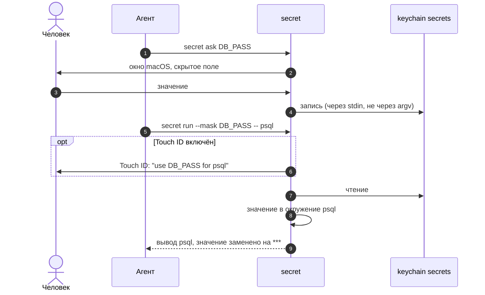

<div align="center">

# secret

**Секреты в keychain macOS, которыми агент пользуется, не видя значений.**


[Быстрый старт](#быстрый-старт) ·
[Как это работает](#как-это-работает) ·
[Возможности](#возможности) ·
[Команды](#команды) ·
[Безопасность](#безопасность) ·
[FAQ](#faq)

</div>

---

```console
$ secret ask GITHUB_TOKEN "Токен из github.com/settings/tokens"   # окно macOS, скрытый ввод
stored: GITHUB_TOKEN

$ secret run --mask GITHUB_TOKEN -- sh -c 'echo "token is $GITHUB_TOKEN"'
token is ***

$ secret ls -l
SHOP_DB_PASSWORD        2026-12-31  shop: пароль учётки PostgreSQL
GITHUB_TOKEN                        GitHub, личный токен для gh
```

Пароли, токены и ключи API лежат в хранилище Secure Enclave: каждое значение зашифровано ключом
из чипа Mac и открывается только после Touch ID или Apple Watch. До переезда они лежат в
отдельном keychain `secrets`, его видно в Keychain Access. Команда `secret` подставляет их в
окружение процесса по имени. Значение человек вводит в окно со скрытым полем, а не в чат агента.
Агент работает только с именами.

## Быстрый старт

```sh
brew install andrewkomkov/secret/secret   # команда, оба helper, автодополнение zsh
secret init                               # создать keychain и задать его пароль
secret ask MY_TOKEN                       # положить первый секрет
secret run --mask MY_TOKEN -- ./deploy.sh
```

Хук Claude Code и приложение SecretBar (для него нужен Xcode):

```sh
"$(brew --prefix secret)/libexec/install.sh" --claude-hook --app
```

Из исходников:

```sh
git clone https://github.com/andrewkomkov/secret-cli && cd secret-cli
./install.sh --claude-hook     # symlink в ~/.local/bin, helper, автодополнение zsh, хук
```

Нужен только macOS. Команда работает на `bash` 3.2 и системных `security`, `osascript`,
`perl`, `openssl`, `xxd`. Для Touch ID в файловом keychain нужен `swiftc` из Command Line Tools
(`xcode-select --install`).

Без сертификата Apple Development helper получает подпись ad-hoc. После обновления, которое
меняет helper хранилища Secure Enclave, команда попросит `secret touchid repair`: одно касание
Touch ID.

### Хранилище Secure Enclave

Helper `build/secret-vault` собирает `swiftc` из Command Line Tools. Xcode, Apple ID и
provisioning profile ему не нужны, срока у подписи нет. Если в системе есть сертификат Apple
Development, `install.sh` подписывает helper им: тогда пересборка не меняет доступ к ключу.

```sh
./install.sh                                 # собирает build/secret-vault
secret migrate --backup ~/secrets-before.bak # копия, перенос, сверка, удаление старых копий
secret touchid status                        # store: secure enclave
secret migrate --back                        # обратно в файловый keychain
```

- Файл `~/.local/share/secret/vault` зашифрован целиком: имён и комментариев в нём не видно.
- Каждое значение внутри ещё зашифровано открытым ключом из Secure Enclave. Закрытый ключ
  работает только после Touch ID, Apple Watch или пароля Mac. Запись идёт без Touch ID.
- Ключ файла и grace лежат в записи keychain входа. Без вопроса её читает только helper.
- Если запись keychain изменила другая программа, helper останавливается и окно пароля не
  показывает. `secret touchid repair` после одного касания восстанавливает запись из файла.
- Grace скользящий: 30 минут без запросов, не больше 8 часов. Блокировка экрана, сон и
  `secret lock` заканчивают его сразу.

## Как это работает



Значение идёт мимо контекста агента и при записи, и при чтении. Если агент всё же
пробует вывести значение (`secret get`, `cat .env`, `security find-generic-password -w`), хук
Claude Code останавливает команду.

## Возможности

| | |
|---|---|
| **Скрытый ввод** | `secret ask` открывает окно macOS. Значение вводит человек, агент видит только `stored: NAME` |
| **Генерация** | `secret gen` создаёт случайный пароль сразу в keychain, его не видит никто |
| **Маскировка вывода** | `secret run --mask` заменяет значения на `***` в stdout и stderr, в том числе в base64 и URL-кодировании. Под Claude Code включена всегда |
| **Ссылки в `.env`** | `TOKEN=secret:MY_TOKEN` вместо значения; `secret import` переносит готовый `.env` |
| **Журнал доступа** | `secret log`: кто (`agent` или `human`), когда, какие секреты. Значений в журнале нет |
| **Хук Claude Code** | останавливает команды агента, которые печатают значения |
| **Touch ID** | в хранилище Secure Enclave ключ из чипа Mac работает только после Touch ID или Apple Watch. В файловом keychain — защищённый режим: значения читает только подписанный helper |
| **Буфер обмена** | `secret copy` очищает буфер через 30 секунд |
| **Срок жизни** | `-x 2026-12-31`, `secret ls --expiring`, предупреждение при использовании |
| **Бэкап** | `secret export` / `restore`: один файл, AES-256 под отдельным паролем |
| **Автодополнение** | имена секретов по Tab в zsh, без запроса к keychain |

## Команды

**Каждый день**

```sh
secret ask NAME ["подсказка"]        # положить значение через окно
secret run --mask NAME -- cmd        # запустить cmd с секретом в окружении
secret run --mask -e .env -- cmd     # то же, ссылки secret:NAME из .env
secret ls -l                         # имена, сроки, комментарии
secret copy NAME                     # в буфер обмена на 30 секунд
```

**Работа с записями**

```sh
secret gen -l 32 -s symbols -c "комментарий" NAME
secret set -c "комментарий" -x 2026-12-31 NAME < file
secret note NAME "новый комментарий"
secret expire NAME 2027-01-31        # или none
secret mv OLD NEW
secret rm NAME
```

**GitHub Actions**

```sh
secret gh DEPLOY_KEY -R owner/repo             # окно подтверждения, потом gh secret set
secret gh PROD_DB_URL DATABASE_URL -R owner/repo -e production
```

GitHub хранит значение зашифрованным и не отдаёт его обратно. Команде нужен `gh` с
`gh auth login`. Сеть нужна только `secret gh`.

<details>
<summary><b>Полный справочник</b></summary>

| Команда | Что делает |
|---|---|
| `secret init` | создать keychain, задать пароль, добавить в Keychain Access |
| `secret unlock`, `secret lock` | разблокировать, заблокировать |
| `secret ask NAME [TEXT]` | окно macOS со скрытым вводом, значение сохраняется под NAME |
| `secret set [-c COMMENT] [-x YYYY-MM-DD] NAME [VALUE]` | сохранить из stdin, из терминала (скрытый ввод) или из VALUE |
| `secret gen [-l LEN] [-s alnum\|symbols\|hex] [-c COMMENT] [-f] NAME` | случайное значение, LEN 8–256 (по умолчанию 32); значение не печатается |
| `secret note NAME [COMMENT]` | задать или показать комментарий |
| `secret expire NAME YYYY-MM-DD\|none` | задать или убрать срок жизни |
| `secret ls [-l]` | имена; `-l` — со сроком и комментарием |
| `secret ls --expiring [DAYS]` | истёкшие и те, что истекают за DAYS дней (по умолчанию 30) |
| `secret has NAME` | код 0, если секрет есть; ничего не печатает |
| `secret get NAME` | напечатать значение |
| `secret copy NAME [SECONDS]` | в буфер обмена; через SECONDS (по умолчанию 30) буфер очищается, если в нём то же значение |
| `secret gh NAME [GH_NAME] [-R OWNER/REPO] [-e ENV] [-o ORG [-v VISIBILITY]]` | записать значение в GitHub Actions secret GH_NAME (по умолчанию NAME) через `gh secret set`. Каждую отправку человек подтверждает в окне. Флаги идут в `gh` без изменений, `-b` и `-f` запрещены |
| `secret mv [-f] OLD NEW` | переименовать со значением, комментарием и сроком |
| `secret rm NAME` | удалить |
| `secret run [--mask\|--no-mask] [-e FILE]... [SPEC...] -- CMD` | запустить CMD с секретами в окружении. SPEC — `NAME` или `VAR=NAME`. Без SPEC и `-e` читает `./.env`. Под Claude Code (`CLAUDECODE`) вывод маскируется всегда, `--no-mask` не действует |
| `secret check [FILE]` | для каждого ключа `.env`: `ok`, `MISSING` или `plain`; значения не печатает |
| `secret import [-p PREFIX] [-k] [FILE]` | значения `.env` в keychain, в файле — ссылки; `-k` — файл не менять |
| `secret export [-f] [--pass-stdin] FILE` | все секреты в один шифрованный файл |
| `secret restore [-f] [--pass-stdin] FILE` | восстановить; `-f` заменяет секреты, которые уже есть |
| `secret log [-n N] [NAME]` | журнал доступа, последние N строк (по умолчанию 20) |
| `secret touchid on\|off\|status` | защищённый режим: записи переходят к helper, значения — только после Touch ID (`get`, `copy`, `run`, `export`, `mv`) |
| `secret touchid grace SECONDS` | сколько секунд после подтверждения не спрашивать снова: в хранилище Secure Enclave — секунд простоя (по умолчанию 1800), в файловом keychain — от подтверждения (по умолчанию 300); `0` — каждый раз |
| `secret touchid repair` | хранилище Secure Enclave: восстановить запись ключа в keychain из файла хранилища, одно касание |
| `secret migrate --backup FILE`, `--back` | перенести все секреты в хранилище Secure Enclave (сначала копия в FILE) или обратно в файловый keychain |

VALUE в аргументе виден в `ps` и в истории shell, поэтому лучше stdin или `ask`.

</details>

<details>
<summary><b>Переменные окружения</b></summary>

| Переменная | Что делает |
|---|---|
| `SECRET_KEYCHAIN` | другой файл keychain |
| `SECRET_NO_DIALOG=1` | не открывать окна, а завершаться с ошибкой |
| `SECRET_RUN_MASK=1` | `run` всегда с `--mask`; `--no-mask` отменяет для одного запуска |
| `SECRET_LOG` | файл журнала (по умолчанию `~/.local/state/secret/access.log`), `off` — без журнала |
| `SECRET_NAMES_CACHE` | кэш имён для автодополнения (по умолчанию `~/.local/state/secret/names`) |
| `SECRET_LOCK_TIMEOUT` | при `init`: через сколько секунд без работы keychain блокируется (по умолчанию 28800) |
| `SECRET_AUTH_HELPER`, `SECRET_PBCOPY`, `SECRET_PBPASTE`, `SECRET_GH`, `SECRET_CONFIRM` | только для тестов: работают с keychain, у которого другой inode, чем у keychain по умолчанию |

</details>

## Приложение SecretBar

```sh
./install.sh --app      # сборка, /Applications/SecretBar.app, запуск
```

- **Быстрая панель ⌥⌘S** из любого приложения, в стиле Spotlight. Печатаете имя или слово из
  комментария, ↩ копирует значение, ↑↓ выбор, esc закрыть. Поиск понимает строку, набранную не
  в той раскладке: `оутлшты` найдёт `JENKINS_…`.
- **Spotlight.** Секреты ищутся прямо в Spotlight, действие «Скопировать секрет» есть и в
  Shortcuts. В индекс попадают только имена и комментарии, значения — никогда. Настройки →
  «Показывать в Spotlight» выключает и стирает индекс.
- **Значок в строке меню** — замок показывает grace: открыт со временем, закрыт или требует
  внимания. По клику открывается окно: статус, поиск и копирование в один клик.
- **Главное окно**: слева проекты (по комментарию «проект: …»), посередине список, справа
  карточка секрета. В карточке комментарий, срок, файлы `.env` со ссылкой `secret:NAME` и
  готовые строки для `secret run` и `.env`. Здесь же добавление, генерация, изменение,
  переименование, удаление, «Активность» и «Настройки».
- **Копирование** кладёт значение в буфер с пометкой `ConcealedType`, поэтому Raycast, Alfred и
  Paste его не сохраняют. Буфер очищается через 30 секунд. У строки меню появляется плашка
  «Скопировано».
- **Активность** — последние обращения (агент или вы) и окна Touch ID из журнала агента.
- **Уведомления** — секреты истекли или истекают за 7 дней.

Приложение само к keychain не обращается. Все действия идут через `secret` и helper, поэтому
Touch ID, grace и журнал работают как в терминале. Значение в память приложения не попадает:
в буфер его кладёт helper. Подпись — сертификат Apple Development без profile (без него —
ad-hoc), entitlements нет. `tests/run.sh` проверяет это по бинарнику. `SecretBar --snapshot DIR
--theme dark` рисует все экраны в PNG на демо-данных.

## Ссылки в `.env`

```sh
export API_TOKEN=secret:MYAPP_API_TOKEN     # значение в keychain
DB_PASS=secret:MYAPP_DB_PASS
PORT=8080                                   # обычное значение, передаётся как есть
```

```sh
secret import -p MYAPP_ .env    # перенести открытые значения в keychain, в файле оставить ссылки
secret check .env               # ok / MISSING / plain по каждому ключу
secret run --mask -- npm start  # читает ./.env
```

Парсер понимает `export`, комментарии, кавычки `"…"` и `'…'`. Многострочные значения не
поддерживаются. Если проект загружает `.env` через `source`, ссылки останутся строками. Тогда
нужен загрузчик, который после `source` заменяет `secret:NAME` значением. Пример —
`ops/lib/load_env.sh`: он делает `source .env` и потом `secret run`.

## Безопасность

| Угроза | Что делает `secret` | Что остаётся |
|---|---|---|
| Значение попадает в чат агента | ввод через окно `ask`, генерация `gen`, маскировка вывода (под Claude Code всегда; значение, его base64 и URL-кодирование), хук | значение внутри другой кодировки: `base64(user:pass)` в `Authorization: Basic`, hex, значение по частям |
| Значение видно в `ps` | значения идут в `security` через stdin, пароль бэкапа — через файловый дескриптор | `set NAME VALUE` с значением в аргументе |
| Агент читает значение в обход правил | хук останавливает `secret get`, `security ... -w`, `cat .env`, `env` внутри `run` | команду можно составить так, что шаблон хука её не узнает |
| Процесс читает секреты без ведома человека | защищённый режим: создатель записи и единственный читатель — helper, Touch ID внутри helper; журнал доступа | в обычном режиме (`touchid off`) — прямой вызов `security`, пока keychain разблокирован |
| Подмена helper | ACL записи привязан к `cdhash` helper; другой или изменённый бинарник получает отказ без окна; hardened runtime отключает `DYLD_*` и отладчик | процесс, который запускает сам helper, в окно grace (300 с) читает без нового Touch ID; `grace 0` — спрашивать каждый раз |
| Подмена записи | helper читает только свои записи: подменённая даёт `not protected` | комментарий, срок и наличие записи может поменять или удалить любой процесс |
| Агент подписывает свой бинарник сертификатом владельца | хранилище Secure Enclave: ключ значения работает только после `.userPresence`, Touch ID требует система для любого процесса с любой подписью | в grace процесс-агент отвечает любому процессу владельца; grace — 30 минут без запросов, не больше 8 часов; блокировка экрана, сон и `secret lock` его заканчивают |
| Подмена записи ключа хранилища Secure Enclave | helper читает запись только молча; изменённая запись — ошибка без окна; `touchid repair` восстанавливает её из файла после Touch ID | программа владельца может подменить и запись, и файл своим ключом; `repair` с касанием примет его |
| Потеря keychain или Mac | `secret export`: AES-256-CBC, PBKDF2 600 000 итераций, sha256 внутри | пароль keychain и пароль бэкапа не восстанавливаются |
| Значение остаётся в буфере обмена | `copy` очищает буфер через 30 секунд | менеджеры буфера (Raycast, Alfred) могут сохранить значение в истории |

**Хранилище Secure Enclave.** Helper `build/secret-vault` держит один файл. Payload (имена,
комментарии, сроки, значения) зашифрован AES-GCM ключом файла. Каждое значение внутри ещё
зашифровано ECIES открытым ключом из Secure Enclave, поэтому запись идёт без Touch ID, а чтение
требует Touch ID. Ключ файла, открытый ключ, обёртка ключа Secure Enclave и grace лежат в записи
keychain входа `secret-cli.vault`. Её создаёт helper, и без вопроса её читает только он. Другая
программа может перезаписать эту запись. Тогда helper её не прочитает молча, остановится с
ошибкой и окно пароля не покажет. Заголовок файла хранит ключ файла под ключом Secure Enclave,
и `secret touchid repair` после Touch ID создаёт запись заново. Grace держит процесс-агент
helper: после Touch ID он открывает значения и держит их в памяти, сокет
`~/.local/state/secret/vault-agent.sock` доступен только владельцу. Hardened runtime без
`get-task-allow` закрывает эту память от отладчика. Grace скользящий: каждый запрос продлевает
его на время простоя (`secret touchid grace N`, по умолчанию 1800 секунд). Общий предел — 8
часов от Touch ID. Блокировка экрана, сон Mac и `secret lock` заканчивают grace сразу. Ключ
Secure Enclave привязан к этому Mac: на другой Mac секреты переносит `export` и `restore`.

**Keychain.** Записи — generic password, account `secret-cli`, service — имя секрета, kind
`secret-cli`, комментарий в атрибуте `icmt`, срок — в `gena`. Keychain блокируется при сне и
после 8 часов без работы. Если он заблокирован, команда спрашивает его пароль в терминале или в
окне.

**Touch ID.** `secret touchid on` переводит все записи в защищённый режим. Helper
`build/secret-auth` создаёт их заново, и macOS отдаёт значение без окна только создателю
записи. Любой другой процесс, в том числе `security find-generic-password -w`, получает окно с
запросом. Если такое окно появилось без вашей команды, нажмите Deny. Helper спрашивает Touch ID
(или пароль Mac) перед чтением. Одно подтверждение действует 300 секунд (`secret touchid grace
N`). Отметку времени helper подписывает HMAC ключом из записи политики, поэтому подделать её
нельзя. Для `off` и `grace` нужно свежее подтверждение. Если запись политики удалили, helper
спрашивает Touch ID каждый раз.

**Обновление helper.** ACL привязан к `cdhash`, поэтому новая сборка не читает записи старой.
`./install.sh` собирает helper только при изменении исходника. Новая сборка получает записи от
старой: один Touch ID для чтения и один для политики. Если перенос прервался, повторный
`./install.sh` переносит оставшиеся записи. Без helper команды в защищённом режиме завершаются с
ошибкой. Helper ещё проверяет, заблокирован ли keychain, без системного окна `security wants to
use the keychain`.

**Бэкап.** Файл с правами 600, внутри имена, значения, комментарии и сроки в hex и sha256.
Открытый текст и пароль идут к `openssl` через pipe, на диск не попадают. `restore` проверяет
пароль, заголовок и сумму до первой записи. Чтобы расшифровать файл без `secret`, выполните
`openssl enc -d -aes-256-cbc -pbkdf2 -iter 600000 -md sha256 -in FILE`.

## Агент

`./install.sh --claude-hook` подключает Claude Code. Повторный запуск заменяет прежние записи, а
не добавляет вторые.

- Хук `hooks/claude-pretooluse.sh` записывается в `~/.claude/settings.json`. Хук смотрит на
  начало команды (начало строки, после `;`, `&&`, `|`, `$(`). Слова в тексте и в сообщениях
  коммитов он пропускает. Текст heredoc для `cat`, `tee` и `git` хук тоже пропускает: это
  содержимое файла. Команды с `!` в Claude Code человек запускает без хука.
- Правила `docs/claude-md-secrets.md` подключаются строкой `@…/docs/claude-md-secrets.md` в
  `~/.claude/CLAUDE.md`. Claude Code читает файл при старте сессии, поэтому правила обновляются
  вместе с командой. Правила: всегда `run --mask`, новые значения через `ask` или `gen`,
  отправка в GitHub через `secret gh`, настройки Touch ID меняет только человек.
- В журнале запуск из Claude Code помечен `agent` (по переменной `CLAUDECODE`).

## FAQ

<details>
<summary>Почему не 1Password или Bitwarden?</summary>

Им нужен аккаунт и подписка или облако. `secret` работает на том, что уже есть в macOS, и
сделан под работу с агентом: маскировка вывода, хук, журнал с пометкой `agent`.

</details>

<details>
<summary>Как перенести секреты на другой Mac?</summary>

`secret export FILE` на старом, `./install.sh && secret init && secret restore FILE` на новом.

</details>

<details>
<summary>Почему при каждом <code>run</code> спрашивают Touch ID?</summary>

В хранилище Secure Enclave вопрос нужен после 30 минут без запросов, через 8 часов от Touch ID,
после блокировки экрана и после сна Mac. Время простоя меняет `secret touchid grace N`, ноль —
спрашивать каждый раз. `secret touchid status` показывает, сколько осталось. В файловом keychain
одно подтверждение действует 300 секунд.

</details>

<details>
<summary>Нужен ли Xcode?</summary>

Только для SecretBar. Команде и helper хранилища хватает `swiftc` из Command Line Tools
(`xcode-select --install`). Раньше было хранилище data protection keychain, ему нужен был
provisioning profile из Xcode на 7 дней. В версии 018 его заменило хранилище Secure Enclave без
срока.

</details>

<details>
<summary>Команда пишет «another program changed the key item of the store»</summary>

Запись ключа в keychain изменила другая программа, или helper собран без прежнего сертификата.
Секреты целы в файле. `secret touchid repair` после одного касания создаёт запись заново.

</details>

<details>
<summary>По Tab не дописываются имена</summary>

Один раз выполните `secret ls`: он соберёт кэш имён. Потом откройте новый терминал.

</details>

## Разработка

```sh
tests/run.sh    # 309 проверок на временном keychain и тестовой сборке хранилища
```

Тесты создают свои keychain и удаляют их в конце. Рабочий keychain, буфер обмена и список
Keychain Access не меняются. Touch ID проверяет тестовая сборка helper (`-D SECRET_TEST`, ответ
из файла). У неё другой `cdhash`, и к настоящим записям доступа у неё нет. В рабочей сборке
этого кода нет. Хранилище Secure Enclave проверяет тестовая сборка `secret-vault-test`:
программный ключ и ключ файла в каталоге прогона, Secure Enclave и keychain она не трогает.
Заблокированный keychain
проверяется через helper без системного окна. Окна (`ask`, разблокировка) и настоящий Touch ID
проверяются руками.

Изменения идут через spec-kit: `specs/NNN-*/` со `spec.md`, `plan.md`, `tasks.md`. Правила —
в `.specify/memory/constitution.md`.

```
bin/secret                     команда
helper/secret-auth.swift       Touch ID и статус файлового keychain
helper/store/                  helper хранилища Secure Enclave: main.swift, build.sh (swiftc)
app/                           приложение SecretBar: SwiftUI, App Intents, проект Xcode, build.sh
hooks/claude-pretooluse.sh     хук Claude Code
completions/_secret            автодополнение zsh
docs/claude-md-secrets.md      правила для агента
tests/run.sh                   тесты
```
