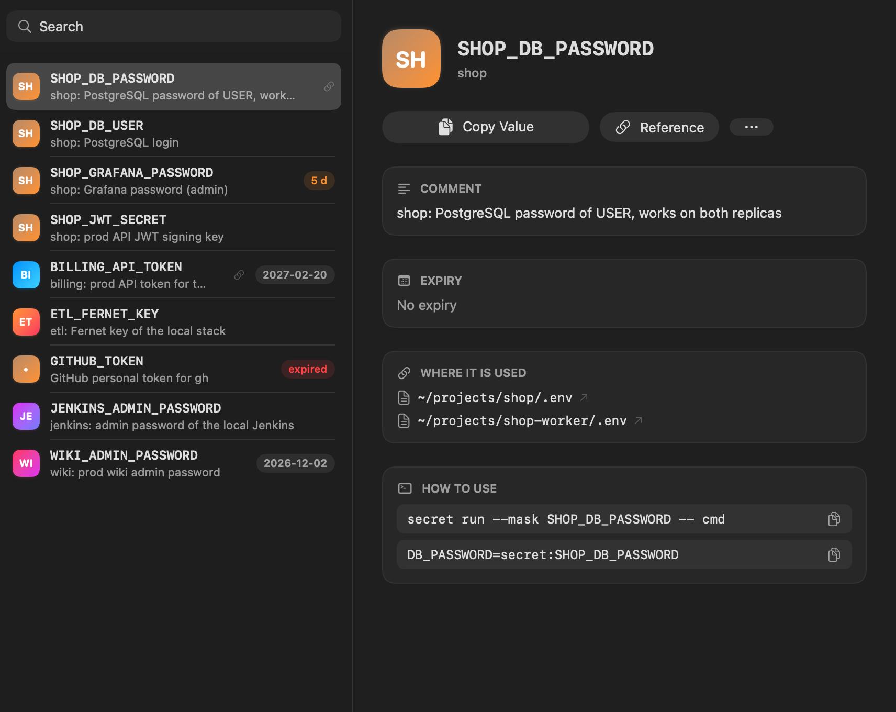
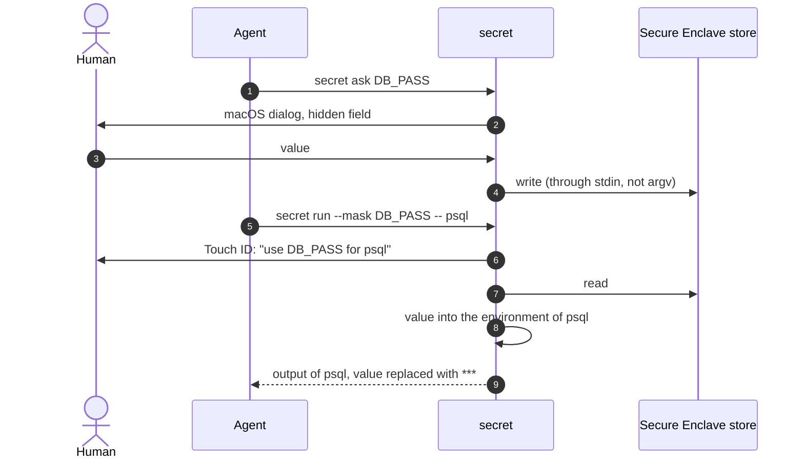
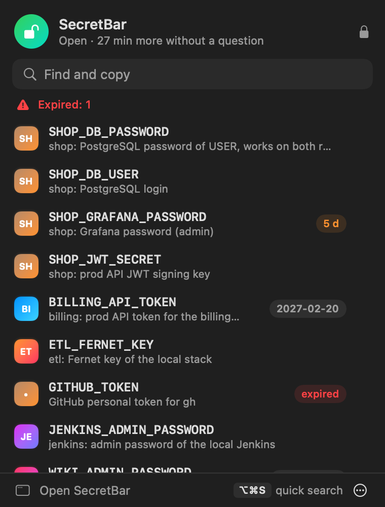
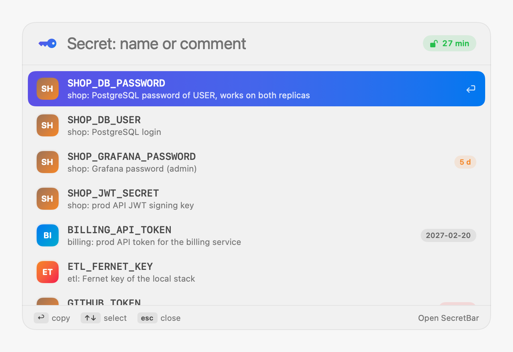

<div align="center">

# secret

**Secrets in the macOS keychain that an AI agent uses by name, without ever seeing a value.**

**English** · [Русский](README.ru.md) · [Website](https://andrewkomkov.github.io/secret-cli/)


[](https://github.com/andrewkomkov/secret-cli/actions/workflows/ci.yml)
[](https://github.com/andrewkomkov/secret-cli/releases)


[Quick start](#quick-start) ·
[How it works](#how-it-works) ·
[Features](#features) ·
[Commands](#commands) ·
[Security](#security) ·
[FAQ](#faq)

</div>

---

```console
$ secret ask GITHUB_TOKEN "Token from github.com/settings/tokens"   # macOS dialog, hidden input
stored: GITHUB_TOKEN

$ secret run --mask GITHUB_TOKEN -- sh -c 'echo "token is $GITHUB_TOKEN"'
token is ***

$ secret ls -l
SHOP_DB_PASSWORD        2026-12-31  shop: PostgreSQL password
GITHUB_TOKEN                        GitHub personal token for gh
```

Passwords, tokens and API keys live in a Secure Enclave store. A key from the chip of your Mac
encrypts each value, and the value opens only after Touch ID or Apple Watch. The `secret` command puts
them into the environment of a process by name. A human types a value into a dialog with a hidden
field, never into the chat with the agent. The agent works with names only.

<p align="center"></p>

## Quick start

```sh
brew install andrewkomkov/secret/secret   # the command, both helpers, zsh completion
secret init                               # create the keychain and set its password
secret ask MY_TOKEN                       # store the first secret
secret run --mask MY_TOKEN -- ./deploy.sh
```

The Claude Code hook and the SecretBar menu bar app (it needs Xcode):

```sh
"$(brew --prefix secret)/libexec/install.sh" --claude-hook --app
```

From source:

```sh
git clone https://github.com/andrewkomkov/secret-cli && cd secret-cli
./install.sh --claude-hook     # symlink in ~/.local/bin, helpers, zsh completion, hook
```

Only macOS is necessary. The command runs on `bash` 3.2 and the system `security`, `osascript`,
`perl`, `openssl` and `xxd`. Touch ID in the file keychain needs `swiftc` from the Command Line
Tools (`xcode-select --install`).

Without an Apple Development certificate the helpers get an ad-hoc signature. After an upgrade
that changes the Secure Enclave helper, the command asks for `secret touchid repair`: one touch.

### Secure Enclave store

`swiftc` from the Command Line Tools builds the helper `build/secret-vault`. Xcode, an Apple ID
or a provisioning profile are not necessary. Its signature does not expire. If the system has an
Apple Development certificate, `install.sh` signs the helper with it: then a rebuild keeps the
access to the key.

```sh
./install.sh                                 # builds build/secret-vault
secret migrate --backup ~/secrets-before.bak # backup, move, verify, delete the old copies
secret touchid status                        # store: secure enclave
secret migrate --back                        # back to the file keychain
```

- The file `~/.local/share/secret/vault` is encrypted as a whole: names and comments are hidden.
- Each value inside is encrypted again with a public key from the Secure Enclave. The private key
  works only after Touch ID, Apple Watch or the Mac password. Writes need no Touch ID.
- The file key and the grace state are in an item of the login keychain. Only the helper reads
  it without a question.
- If another program changes that item, the helper stops and shows no password dialog.
  `secret touchid repair` restores the item from the file after one touch.
- Grace slides: 30 minutes without requests, 8 hours at most. A screen lock, sleep or
  `secret lock` ends it at once.

## How it works



The value goes around the context of the agent both on write and on read. If the agent tries to
print a value anyway (`secret get`, `cat .env`, `security find-generic-password -w`), the Claude
Code hook stops the command.

## Features

| | |
|---|---|
| **Hidden input** | `secret ask` opens a macOS dialog. A human types the value, the agent sees only `stored: NAME` |
| **Generation** | `secret gen` makes a random password directly in the store; nobody sees it |
| **Output masking** | `secret run --mask` replaces values with `***` in stdout and stderr, also in base64 and URL encoding. Always on under Claude Code |
| **References in `.env`** | `TOKEN=secret:MY_TOKEN` instead of the value; `secret import` moves an existing `.env` |
| **GitHub Actions** | `secret gh NAME -R owner/repo` sends a value to `gh secret set` through stdin, after a confirmation dialog |
| **Access log** | `secret log`: who (`agent` or `human`), when, which secrets. No values in the log |
| **Claude Code hook** | stops agent commands that would print values |
| **Touch ID** | in the Secure Enclave store the key from the chip works only after Touch ID or Apple Watch |
| **Clipboard** | `secret copy` clears the clipboard after 30 seconds |
| **Expiry** | `-x 2026-12-31`, `secret ls --expiring`, a warning on use |
| **Backup** | `secret export` / `restore`: one file, AES-256 under a separate password |
| **Menu bar app** | SecretBar: ⌥⌘S quick search, Spotlight, a card for each secret, activity |
| **Completion** | secret names on Tab in zsh, without a request to the store |

## Commands

**Every day**

```sh
secret ask NAME ["hint"]             # store a value through a dialog
secret run --mask NAME -- cmd        # run cmd with the secret in its environment
secret run --mask -e .env -- cmd     # the same, secret:NAME references from .env
secret ls -l                         # names, expiry dates, comments
secret copy NAME                     # to the clipboard for 30 seconds
```

**Items**

```sh
secret gen -l 32 -s symbols -c "comment" NAME
secret set -c "comment" -x 2026-12-31 NAME < file
secret note NAME "new comment"
secret expire NAME 2027-01-31        # or none
secret mv OLD NEW
secret rm NAME
```

**GitHub Actions**

```sh
secret gh DEPLOY_KEY -R owner/repo             # confirmation dialog, then gh secret set
secret gh PROD_DB_URL DATABASE_URL -R owner/repo -e production
```

GitHub keeps the value encrypted and never gives it back. The command needs `gh` after
`gh auth login`. Only `secret gh` uses the network.

<details>
<summary><b>Full reference</b></summary>

| Command | What it does |
|---|---|
| `secret init` | create the keychain, set its password, add it to Keychain Access |
| `secret unlock`, `secret lock` | unlock, lock |
| `secret ask NAME [TEXT]` | a macOS dialog with hidden input; the value is stored as NAME |
| `secret set [-c COMMENT] [-x YYYY-MM-DD] NAME [VALUE]` | store from stdin, from the terminal (hidden input) or from VALUE |
| `secret gen [-l LEN] [-s alnum\|symbols\|hex] [-c COMMENT] [-f] NAME` | a random value, LEN 8–256 (default 32); the value is not printed |
| `secret note NAME [COMMENT]` | set or show the comment |
| `secret expire NAME YYYY-MM-DD\|none` | set or remove the expiry date |
| `secret ls [-l]` | names; `-l` adds the expiry date and the comment |
| `secret ls --expiring [DAYS]` | expired and expiring within DAYS days (default 30) |
| `secret has NAME` | exit 0 if the secret exists; prints nothing |
| `secret get NAME` | print the value |
| `secret copy NAME [SECONDS]` | to the clipboard; after SECONDS (default 30) the clipboard is cleared if it still holds the value |
| `secret gh NAME [GH_NAME] [-R OWNER/REPO] [-e ENV] [-o ORG [-v VISIBILITY]]` | store the value as the GitHub Actions secret GH_NAME (default NAME) through `gh secret set`. A human confirms each push in a dialog. Flags go to `gh` unchanged; `-b` and `-f` are refused |
| `secret mv [-f] OLD NEW` | rename with the value, comment and expiry date |
| `secret rm NAME` | delete |
| `secret run [--mask\|--no-mask] [-e FILE]... [SPEC...] -- CMD` | run CMD with secrets in its environment. SPEC is `NAME` or `VAR=NAME`. Without SPEC and `-e` it reads `./.env`. Under Claude Code (`CLAUDECODE`) the output is always masked and `--no-mask` has no effect |
| `secret check [FILE]` | for each key of a `.env`: `ok`, `MISSING` or `plain`; prints no values |
| `secret import [-p PREFIX] [-k] [FILE]` | `.env` values into the store, references into the file; `-k` keeps the file |
| `secret export [-f] [--pass-stdin] FILE` | all secrets into one encrypted file |
| `secret restore [-f] [--pass-stdin] FILE` | restore; `-f` replaces secrets that exist |
| `secret log [-n N] [NAME]` | the access log, the last N lines (default 20) |
| `secret touchid on\|off\|status` | file keychain protected mode: only the helper reads values, after Touch ID |
| `secret touchid grace SECONDS` | how long after a confirmation not to ask again: idle seconds in the Secure Enclave store (default 1800), seconds from the confirmation in the file keychain (default 300); `0` asks every time |
| `secret touchid repair` | Secure Enclave store: rebuild its keychain item from the store file, one touch |
| `secret migrate --backup FILE`, `--back` | move all secrets to the Secure Enclave store (backup to FILE first) or back to the file keychain |
| `secret version` | print the version |

VALUE as an argument shows in `ps` and in the shell history. Use stdin or `ask`.

</details>

<details>
<summary><b>Environment variables</b></summary>

| Variable | What it does |
|---|---|
| `SECRET_KEYCHAIN` | another keychain file |
| `SECRET_NO_DIALOG=1` | open no dialogs, fail instead |
| `SECRET_RUN_MASK=1` | `run` always with `--mask`; `--no-mask` cancels it for one run |
| `SECRET_LOG` | the log file (default `~/.local/state/secret/access.log`), `off` for no log |
| `SECRET_NAMES_CACHE` | the name cache for completion (default `~/.local/state/secret/names`) |
| `SECRET_LOCK_TIMEOUT` | on `init`: idle seconds before the keychain locks (default 28800) |
| `SECRET_AUTH_HELPER`, `SECRET_PBCOPY`, `SECRET_PBPASTE`, `SECRET_GH`, `SECRET_CONFIRM` | tests only: they work only with a keychain whose inode differs from the default one |

</details>

## SecretBar

<p align="center">
  
  
</p>

```sh
./install.sh --app      # build, /Applications/SecretBar.app, launch
```

- **Quick search ⌥⌘S** from any app, in the style of Spotlight. Type a name or a word from the
  comment. ↩ copies the reference `secret:NAME`, ⇧↩ copies the value, ⌘N adds a secret, esc closes. Search understands text typed in the wrong
  keyboard layout.
- **Spotlight.** Secrets show up in Spotlight, and the action "Copy Secret" is in Shortcuts. The
  index gets only names and comments, never values. Settings → "Show in Spotlight" turns it off
  and erases the index.
- **Menu bar icon**: the lock shows the grace state: open with the time left, closed, or needs
  attention. A click opens a panel with the status and search. ↩ or a click copies the reference, ⇧↩ or ⇧-click the value. The + button adds a secret. If search finds nothing, ↩ creates a secret with that name.
- **Main window**: projects on the left (from the comment "project: …"), the list in the middle,
  the card of the secret on the right. The card shows the comment, the expiry date, the `.env`
  files that refer to `secret:NAME`, and ready lines for `secret run` and `.env`. Add, generate,
  edit, rename, delete, Activity and Settings are here too. After you add a secret, its
  reference `secret:NAME` is on the clipboard.
- **Copy** puts the value on the clipboard with the `ConcealedType` mark, so Raycast, Alfred and
  Paste do not keep it. The clipboard is cleared after 30 seconds.
- **Activity**: the latest requests (agent or you) and the Touch ID prompts from the agent log.
- **Notifications**: secrets expired or expiring within 7 days.
- **Languages**: English and Russian, after the language of macOS.

The app never calls the keychain itself. All actions go through `secret` and the helper, so
Touch ID, grace and the log work as in the terminal. A value never gets into the memory of the
app: the helper puts it on the clipboard. The signature is an Apple Development certificate
without a profile, or ad-hoc. The app has no entitlements. `tests/run.sh` checks this on the
binary. `SecretBar --snapshot DIR --theme dark` renders each screen to PNG with demo data.

## References in `.env`

```sh
export API_TOKEN=secret:MYAPP_API_TOKEN     # the value is in the store
DB_PASS=secret:MYAPP_DB_PASS
PORT=8080                                   # a plain value, passed as is
```

```sh
secret import -p MYAPP_ .env    # move plain values into the store, leave references in the file
secret check .env               # ok / MISSING / plain for each key
secret run --mask -- npm start  # reads ./.env
```

The parser understands `export`, comments, `"…"` and `'…'` quotes. Multi-line values are not
supported. If a project loads `.env` with `source`, the references stay strings. Then it needs a
loader that replaces `secret:NAME` with the value after `source`, for example one that runs
`source .env` and then `secret run`.

## Security

| Threat | What `secret` does | What remains |
|---|---|---|
| A value gets into the chat of the agent | input through the `ask` dialog, generation with `gen`, output masking (always under Claude Code; the value, its base64 and URL encoding), the hook | a value inside another encoding: `base64(user:pass)` in `Authorization: Basic`, hex, a value in parts |
| A value shows in `ps` | values go to `security` through stdin, the backup password through a file descriptor | `set NAME VALUE` with the value as an argument |
| The agent reads a value around the rules | the hook stops `secret get`, `security ... -w`, `cat .env`, `env` inside `run` | a command can be written so that the hook pattern does not match it |
| A process reads secrets without the human | Secure Enclave: the key works only after `.userPresence`; the system asks Touch ID for any process with any signature; the access log | in grace the helper agent answers any process of the owner; grace is 30 idle minutes, 8 hours at most; a screen lock, sleep and `secret lock` end it |
| Replaced key item of the store | the helper reads the item only silently; a changed item is an error without a dialog; `touchid repair` restores it from the file after Touch ID | a program of the owner can replace both the item and the file with its own key; `repair` with a touch accepts it |
| Loss of the keychain or the Mac | `secret export`: AES-256-CBC, PBKDF2 600 000 iterations, sha256 inside | nobody can recover the keychain password or the backup password |
| A value stays on the clipboard | `copy` clears the clipboard after 30 seconds | clipboard managers can keep the value in their history |

**Secure Enclave store.** The helper `build/secret-vault` keeps one file. AES-GCM under the
file key encrypts the payload: names, comments, expiry dates and values. ECIES under a public key
from the Secure Enclave encrypts each value again. Thus writes need no Touch ID, and reads need
Touch ID. The login keychain item `secret-cli.vault` holds the file key, the public key, the
wrapped Secure Enclave key and the grace state. Only the helper reads it without a question.

The grace lives in a helper agent process. After Touch ID it opens the values and keeps them in
memory. Its socket `~/.local/state/secret/vault-agent.sock` is open to the owner only. Hardened
runtime without `get-task-allow` closes that memory to a debugger. The Secure Enclave key is
bound to this Mac. `export` and `restore` move secrets to another Mac.

**File keychain.** Items are generic passwords with account `secret-cli`, service = the name of
the secret, kind `secret-cli`, the comment in `icmt`, the expiry date in `gena`. The keychain
locks on sleep and after 8 idle hours. When it is locked, the command asks for its password in
the terminal or in a dialog. `secret touchid on` moves all items to protected mode. The helper
`build/secret-auth` creates them again. macOS gives a value without a dialog only to the creator
of the item.

**Backup.** A file with mode 600: names, values, comments and expiry dates in hex, with sha256.
The plain text and the password go to `openssl` through a pipe and never touch the disk.
`restore` checks the password, the header and the sum before the first write. To decrypt without
`secret`: `openssl enc -d -aes-256-cbc -pbkdf2 -iter 600000 -md sha256 -in FILE`.

## Agent

`./install.sh --claude-hook` connects Claude Code. A second run replaces the earlier entries.

- The hook `hooks/claude-pretooluse.sh` goes into `~/.claude/settings.json`. It looks at the
  start of each command (start of line, after `;`, `&&`, `|`, `$(`). Words in text and in commit
  messages pass, as does heredoc text for `cat`, `tee` and `git`.
- The rules `docs/claude-md-secrets.md` are imported with a line `@…/docs/claude-md-secrets.md`
  in `~/.claude/CLAUDE.md`. Claude Code reads the file at the start of a session, so the rules
  update with the command. The rules: always `run --mask`, new values through `ask` or `gen`,
  GitHub through `secret gh`, only a human changes the Touch ID settings.
- The log marks a run from Claude Code as `agent` (by the `CLAUDECODE` variable).

## FAQ

<details>
<summary>Why not 1Password or Bitwarden?</summary>

They need an account and a subscription or a cloud. `secret` runs on what macOS already has.
It is made for work with an agent: output masking, the hook, a log that marks the agent.

</details>

<details>
<summary>How do I move secrets to another Mac?</summary>

On the old Mac, run `secret export FILE`. On the new one, run
`brew install andrewkomkov/secret/secret && secret init && secret restore FILE`.

</details>

<details>
<summary>Why does each <code>run</code> ask for Touch ID?</summary>

In the Secure Enclave store a question comes after 30 minutes without requests, 8 hours after
Touch ID, after a screen lock and after sleep. `secret touchid grace N` changes the idle time.
Zero asks every time. `secret touchid status` shows the time left.

</details>

<details>
<summary>Do I need Xcode?</summary>

Only for SecretBar. The command and the store helper need only `swiftc` from the Command Line
Tools (`xcode-select --install`).

</details>

<details>
<summary>The command says "another program changed the key item of the store"</summary>

Another program changed the key item in the keychain, or the helper was built without the earlier
certificate. The secrets are safe in the file. `secret touchid repair` creates the item again
after one touch.

</details>

<details>
<summary>Tab does not complete names</summary>

Run `secret ls` once: it builds the name cache. Then open a new terminal.

</details>

## Development

```sh
tests/run.sh    # 340+ checks on a temporary keychain and a test build of the store
```

The tests create their own keychains and delete them at the end. The real keychain, the
clipboard and the Keychain Access list do not change. A test build of the helper
(`-D SECRET_TEST`, answers from a file) checks Touch ID. It has another `cdhash` and no access to
real items. A test build `secret-vault-test` checks the Secure Enclave store with a software key
in the run directory. Dialogs and real Touch ID are checked by hand. CI runs the same suite on a
macOS runner for each push and pull request.

Each change goes through spec-kit: `specs/NNN-*/` with `spec.md`, `plan.md`, `tasks.md`. The rules
are in `.specify/memory/constitution.md`. Commits follow Conventional Commits. release-please
makes the release pull request, the tag and the changelog. Then CI updates the Homebrew formula.

```
bin/secret                     the command
helper/secret-auth.swift       Touch ID and status of the file keychain
helper/store/                  the Secure Enclave helper: main.swift, build.sh (swiftc)
app/                           SecretBar: SwiftUI, App Intents, Xcode project, build.sh
hooks/                         Claude Code hook and its installer
completions/_secret            zsh completion
docs/claude-md-secrets.md      rules for the agent
site/                          the website (GitHub Pages)
tests/run.sh                   tests
```

## License

MIT
